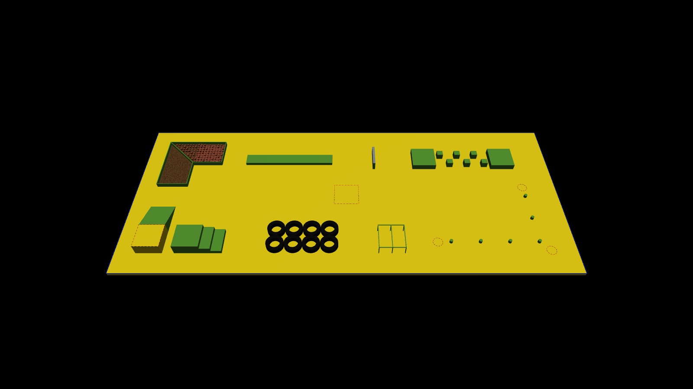
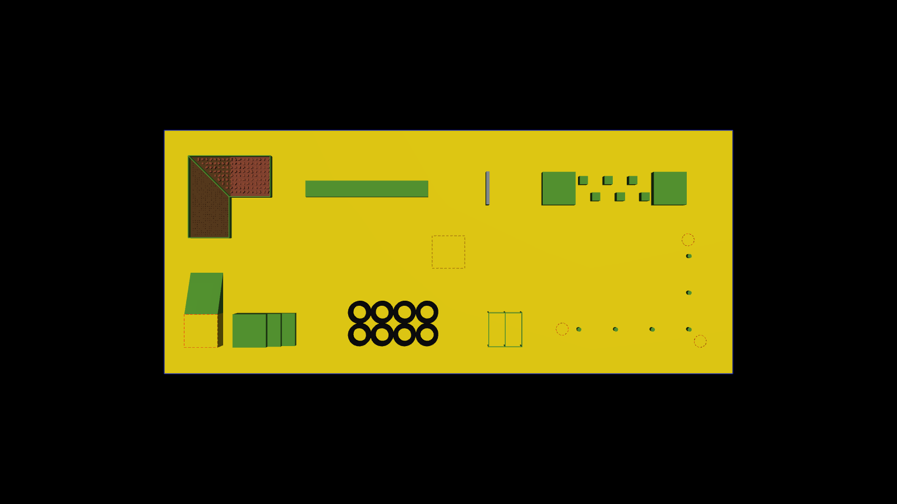
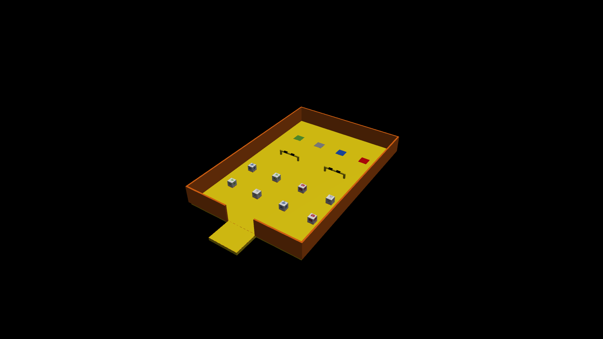
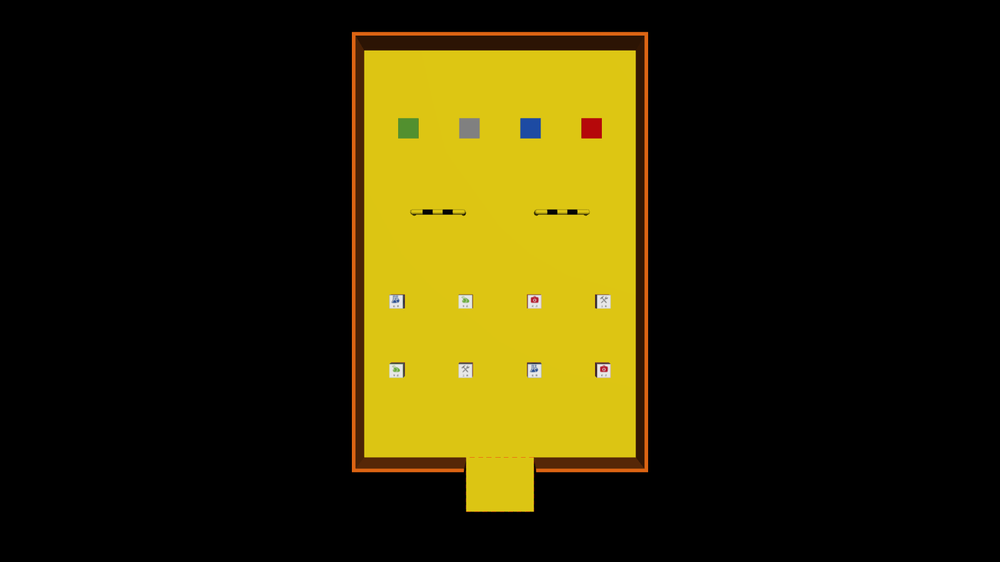
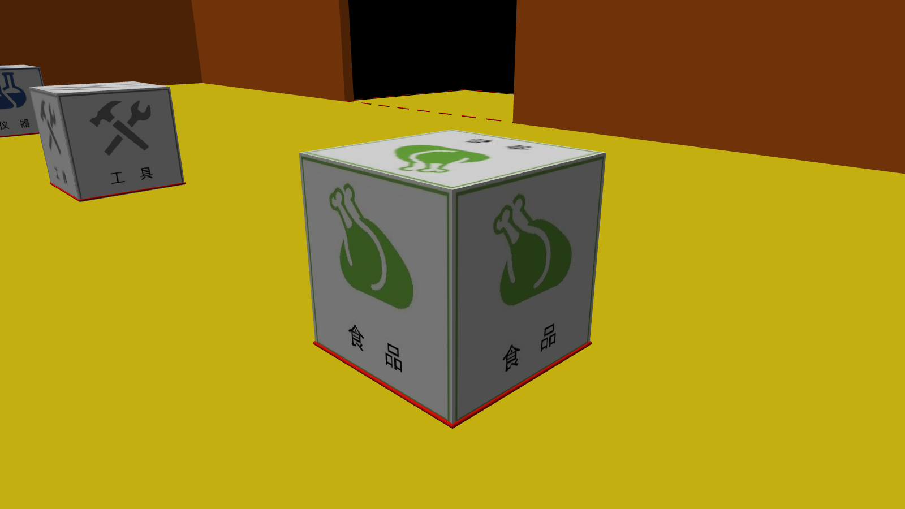
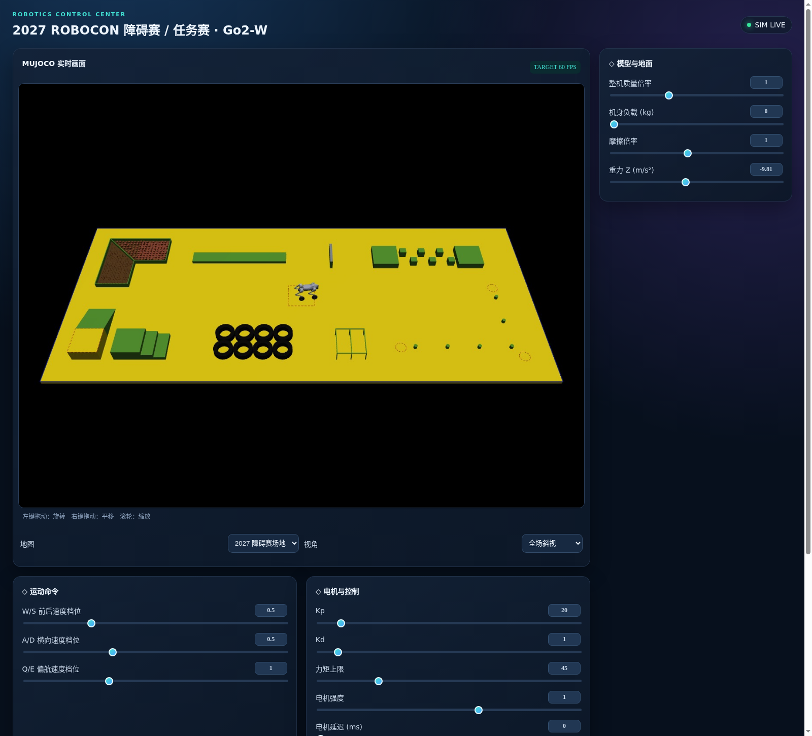
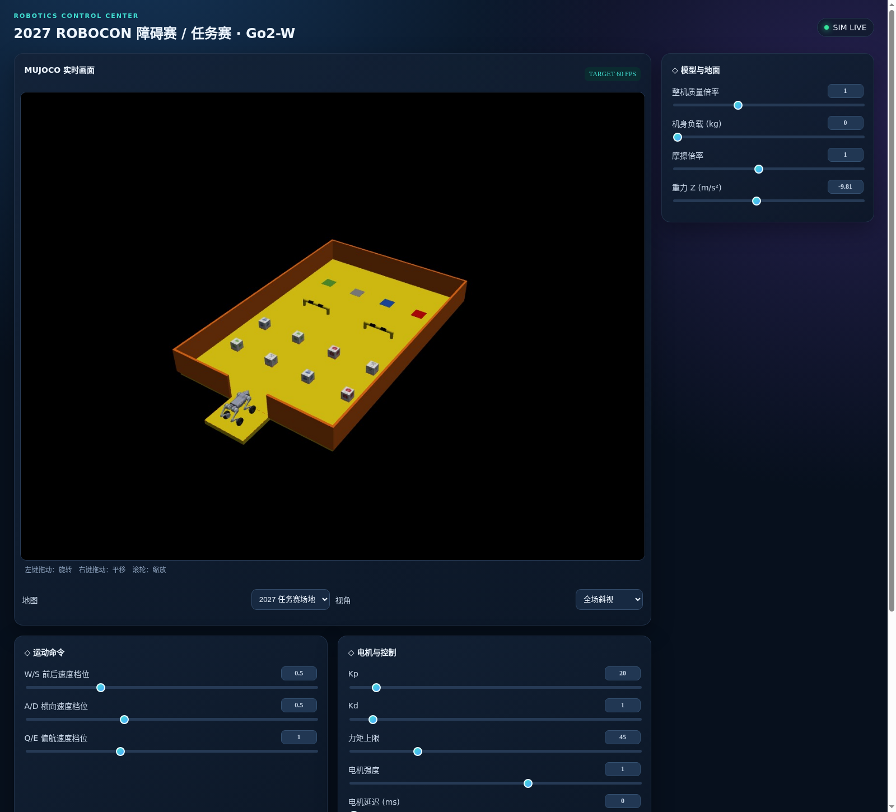

# 图片介绍

以下图片均由项目实际 MuJoCo 场景渲染或运行中的浏览器面板截取。场地展示图采用与默认 GUI 一致的无投影光照；箱子位置和颜色对应当前生成器的训练布局。

## 障碍赛：整体布局

黄色底板为 14 × 6 m 场地。图中包含全部八类障碍，绕桩和沟壑组合均呈 L 形；轮胎用分段环形几何建模，中间保留可落脚的孔洞。最终比赛摆放位置未公布，这里采用规则示意图的相对布局。

俯视图用于核对障碍之间的通道和启动位置。中心红色虚线方框为启动区 1；沟壑斜坡侧顶部黄色平台为启动区 2。场地边界为标线，没有额外围墙。

## 任务赛：存放、归位与通行

6 × 4 m 内场以橘黄围墙包围。近侧两行摆放 8 个动态物资箱，中段为两道黄黑挡车杆，远侧四个色块为归位区。启动区依据示意图放在场外，南墙留出入口。

存放区为 2 × 4 布局，箱子边长 200 mm；归位区为 300 mm 方形，绿、灰、蓝、红分别对应食品、工具、仪器、药品。两道挡车杆之间净通道宽 1 m。

## 物资箱：六面标识

每类物资箱有两个实例，均为 0.25 kg 的独立刚体。图片使用规则 PDF 的原始标识；箱子的四个侧面文字保持向上，顶面和底面也带有同类标识。外观由一个六面纹理立方体构成，碰撞由独立的 200 mm 箱体处理。

## 浏览器控制面板

两图来自同一个浏览器面板。画面下方的地图选择菜单可以切换比赛场地，视角菜单提供跟随、全场斜视和俯视。右侧展示模型与地面参数；向下滚动还能看到速度、执行器设置、实时曲线与操作按钮。

默认画面为 1280 × 960、目标 60 FPS、JPEG 质量 92。这里展示的机器人用于验证行走和控制链路，不代表已经具备抓取或比赛任务能力。
